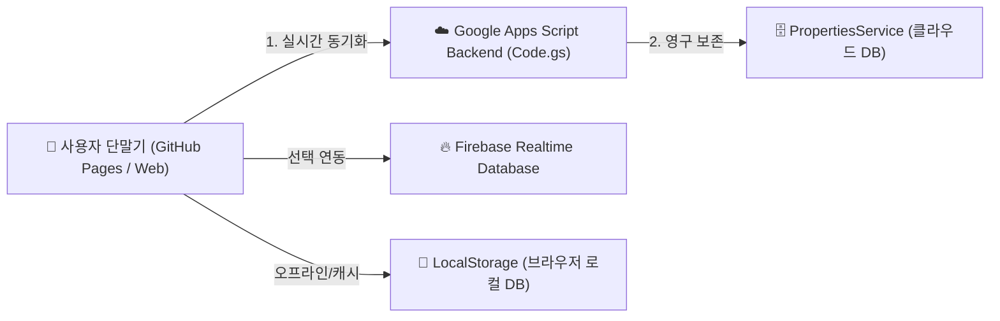

# 🎾 베스트 테니스 클럽 - 월례대회 경기 자동 매칭 및 통계 분석 시스템

<div align="center">

[](https://dydrb87-eng.github.io/BestTennis/)
[](https://script.google.com/macros/s/AKfycbxEzbBXN39gfAMB8SgtHm3Q2Dzn6iNGYLlmQSrFYRA/exec)
[](https://opensource.org/licenses/MIT)

**공정한 출전 기회 배분, 연속 경기 방지(휴식 보장), 파트너 중복 최소화 알고리즘이 적용된 스마트 테니스 클럽 대회 운영 웹 앱**

</div>

---

## 🌐 서비스 접속 및 배포 링크

이 프로젝트는 **GitHub Pages**를 통해 고속 정적 웹 호스팅으로 배포되어 있으며, **Google Apps Script** 백엔드 클라우드와 완벽하게 연동됩니다.

| 플랫폼 / 환경 | 서비스 URL | 용도 및 특징 |
| :--- | :--- | :--- |
| **🚀 GitHub Pages (웹 배포)** | [**https://dydrb87-eng.github.io/BestTennis/**](https://dydrb87-eng.github.io/BestTennis/) | 전용 고속 웹 서비스 (모바일/PC 반응형 최적화) |
| **☁️ Google Apps Script (실행)** | [**바로가기 (exec 주소)**](https://script.google.com/macros/s/AKfycbxEzbBXN39gfAMB8SgtHm3Q2Dzn6iNGYLlmQSrFYRA/exec) | 구글 계정 기반 독립 웹 앱 호스팅 |
| **📦 GitHub 원격 저장소** | [**https://github.com/dydrb87-eng/BestTennis**](https://github.com/dydrb87-eng/BestTennis) | 오픈소스 코드 및 업데이트 내역 관리 |

---

## 🏗️ 백엔드(Backend) 및 데이터베이스 구성

본 시스템은 서버 유지비용이 전혀 들지 않는 **서버리스(Serverless) 클라우드 아키텍처**로 구성되어 있습니다.



### 1. 백엔드 구성 요소 (`google_apps_script/Code.gs`)
- **`doGet(e)`**: 웹 브라우저 접속 시 최신 버전의 단일 인터페이스(`index.html`) 렌더링.
- **`getCloudData()`**: 서버에 저장된 월별 대회 기록, 참가자 명단, 경기 결과 및 점수를 조회하여 클라이언트로 전송.
- **`saveCloudData(jsonString)`**: 클라이언트에서 경기 점수 입력, 대진표 생성, 참가자 수정 시 `PropertiesService`를 통해 클라우드 영구 저장소에 실시간 동기화.

### 2. 다중 백업 및 데이터 안전망
- **Local Storage 캐싱**: 네트워크 끊김 상황에서도 로컬 브라우저에 즉시 저장되어 데이터 유실을 100% 방지.
- **JSON 백업 / 복원**: 대회 운영자가 `[데이터 백업]` 버튼을 클릭해 전체 데이터를 JSON 파일로 즉시 다운로드하거나, 이전 데이터를 손쉽게 원클릭 복원 가능.

---

## ✨ 핵심 기능

### 1. 👥 참가자 및 출결 관리 (Tab 1)
- **명단 등록 & 엑셀 업로드**: 엑셀(.xlsx, .csv) 파일을 끌어다 놓거나 드롭다운으로 참가자 일괄 등록.
- **지각자 보정 기능 (`+1`)**: 뒤늦게 도착한 참가자가 출전 경기 수가 0개라는 이유로 연달아 배정되는 현상을 방지하기 위해 가상 출전 수(`+1`) 부여.

### 2. ⚡ 지능형 경기 자동 매칭 알고리즘 (Tab 2)
- **출전 기회 균등 배분**: 현재 시점에서 출전 수가 가장 적은 선수를 최우선 선발하여 모든 회원이 동일한 경기 수를 소화하도록 배분.
- **연속 경기 엄격 차단 (Back-to-Back 방지)**: 직전 경기에 참여한 선수는 다음 경기에서 자동으로 제외하여 필수 휴식 보장.
- **파트너 중복 최소화**: 누적된 파트너 기록을 추적하여 이전에 같은 편을 해보지 않은 회원끼리 우선 짝을 구성.
- **남복 / 여복 / 혼복 지원**: 성별 비율 및 출전 현황에 따라 최적의 종목 자동 선발.

### 3. 🎯 대진 조정 및 인터랙티브 교체
- **1:1 원클릭 선수 교체**: GAME 내 또는 다른 GAME 간에 선수를 클릭하여 즉시 1:1 맞교환 (출전 기록 및 파트너 이력 자동 재계산).
- **선수 삭제 및 빈 슬롯 채우기**: 특정 선수를 삭제(`✕`)하여 빈칸으로 만든 뒤 드롭다운 목록에서 다른 선수 즉시 지정.
- **통계 반영/미반영 토글**: 평균 출전 수를 초과한 회원의 기록만 개별적으로 통계 집계에서 배제(`-1` 뱃지 실시간 표시).

### 4. 📊 누적 통계 및 순위 리더보드 (Tab 3)
- 경기 스코어 입력 즉시 **순위, 출전수, 승, 패, 승률(%), 득점, 실점, 득실차** 실시간 계산.
- 월별/다중 월 선택 필터링 및 **엑셀(Excel) 내보내기 / PDF 저장** 지원.

### 5. 🔒 관리자 전용 보안 모드
- **초기 비밀번호**: `0001`
- 스코어 입력, 라운드 생성, 선수 교체/삭제, 엑셀 업로드 등 핵심 수정 기능은 관리자 로그인 시에만 활성화되어 일반 회원의 오작동 차단.
- 상단 **[🔑 비번 변경]** 메뉴를 통해 비밀번호를 안전하게 변경 가능.

---

## 📂 프로젝트 구조

```text
BestTennis/
├── .git/                      # Git 버전 관리 디렉토리
├── css/
│   └── style.css              # 테니스 코트 테마 스타일시트
├── google_apps_script/
│   ├── Code.gs                # GAS 서버리스 백엔드 (doGet, 데이터 I/O)
│   └── index.html             # GAS 배포용 단일 실행 파일
├── js/
│   ├── app.js                 # 메인 앱 제어 및 네비게이션
│   ├── matching.js            # 지능형 매칭 & 대진표 알고리즘
│   ├── participants.js        # 참가자 관리 모듈
│   ├── stats.js               # 승률 및 통계 계산 모듈
│   └── firebase-config.js     # Firebase 실시간 DB 연동 모듈
├── index.html                 # GitHub Pages 서비스 메인 페이지
├── vercel.json                # 정적 호스팅 설정
└── README.md                  # 프로젝트 안내 및 배포 문서
```

---

## 💻 로컬 개발 및 실행

별도의 빌드 과정 없이 정적 웹 서버 또는 브라우저에서 `index.html`을 바로 열어 실행할 수 있습니다.

```bash
# 저장소 복제
git clone https://github.com/dydrb87-eng/BestTennis.git

# 폴더 이동
cd BestTennis

# 로컬 웹 서버 실행 (Python 3 기준)
python -m http.server 8000
```
브라우저에서 `http://localhost:8000`으로 접속하여 즉시 테스트할 수 있습니다.
