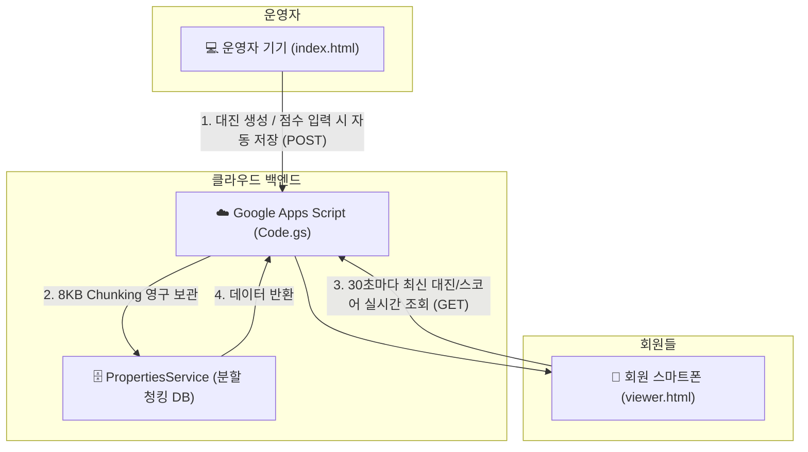

# 🎾 베스트 테니스 클럽 - 월례대회 경기 자동 매칭 및 통계 분석 시스템

**공정한 출전 기회 배분, 연속 경기 방지(휴식 보장), 파트너 중복 최소화 알고리즘이 적용된 스마트 테니스 클럽 대회 운영 웹 앱**

---

## 🌐 서비스 접속 및 배포 링크

이 프로젝트는 **단일 GitHub 저장소** 내에서 경기 운영자가 자유롭게 수정하는 **운영용 페이지**와 일반 회원들이 스마트폰으로 점수와 대진을 실시간 확인하는 **회원용 전광판 뷰어**를 동시에 제공합니다.

| 구분 | 서비스 접속 URL | 주요 용도 및 특징 |
| :--- | :--- | :--- |
| **🏸 운영/수정 메인 페이지** | [**https://dydrb87-eng.github.io/BestTennis/**](https://dydrb87-eng.github.io/BestTennis/) | **비밀번호 없이 즉시 사용 가능!** 대진표 생성, 스코어 입력, 지각자 보정, 선수 교체 등 전체 관리 기능 |
| **👀 회원용 실시간 전광판** | [**https://dydrb87-eng.github.io/BestTennis/viewer.html**](https://dydrb87-eng.github.io/BestTennis/viewer.html) | **일반 회원 열람 전용**. 실수로 데이터가 수정되지 않도록 수정 버튼이 숨겨져 있으며, **30초마다 자동 새로고침** |
| **☁️ 구글 백엔드 API** | [**바로가기 (GAS Web App)**](https://script.google.com/macros/s/AKfycbxEzbBXN39gfAMB8SgtHm3Q2Dzn6iNGYLlmQSrFYRA/exec) | Google Apps Script REST API (클라우드 DB 영구 보존) |
| **📦 GitHub 원격 저장소** | [**https://github.com/dydrb87-eng/BestTennis**](https://github.com/dydrb87-eng/BestTennis) | 오픈소스 소스코드 및 버전 관리 |

> 💡 **별도의 저장소를 만들 필요가 없습니다!**  
> GitHub Pages는 단일 저장소(`BestTennis`) 안에서 `index.html`(운영자용)과 `viewer.html`(회원용)을 모두 독립된 웹 주소로 호스팅합니다. 카카오톡이나 밴드에는 회원용 주소(`viewer.html`)만 공유하시면 됩니다.

---

## 🏗️ 백엔드(Backend) 및 데이터 동기화 구조

어느 기기(PC, 태블릿, 스마트폰)에서 접속하여 수정하더라도 모든 회원이 동일한 최신 데이터를 볼 수 있도록 **서버리스 클라우드 DB 연동** 구조로 동작합니다.

### 1. 백엔드 구성 요소 (`google_apps_script/Code.gs`)
- **`doGet(e)`**: 
  - `?action=getData` 요청 시 구글 클라우드에 보관된 최신 대회 데이터를 JSON으로 즉시 반환.
  - 브라우저 직접 접속 시 웹 애플리케이션 화면 렌더링.
- **`doPost(e)`**: 
  - GitHub Pages 또는 모바일 웹에서 경기 결과 입력 시 구글 클라우드 DB에 즉시 영구 저장.
- **`PropertiesService` 청킹(Chunking) 기술**: 
  - 구글의 9KB 단일 속성 제한을 극복하기 위해 데이터를 8KB 단위로 자동 분할 저장하여 수십 개월 치 대규모 대회 기록도 유실 없이 안전하게 보관.

### 2. 다중 데이터 안전망
- **Local Storage 즉시 캐싱**: 접속 시 0.1초 만에 화면이 먼저 뜨고, 백그라운드에서 구글 클라우드 최신 데이터를 동기화하여 체감 속도 극대화.
- **JSON 전체 백업 / 복원**: 운영자가 언제든 `[데이터 백업]` 버튼을 눌러 컴퓨터에 전체 백업 파일을 다운로드하거나 복원 가능.

---

## ✨ 핵심 기능

### 1. 👥 참가자 및 출결 관리 (Tab 1)
- **명단 등록 & 엑셀 업로드**: 엑셀(.xlsx, .csv) 파일을 끌어다 놓거나 클릭하여 참가자 일괄 등록.
- **지각자 보정 기능 (`+1` / `-1`)**: 늦게 도착한 참가자가 출전 수가 0회라는 이유로 연달아 배정되는 것을 막기 위해 가상 출전 수(`+1`) 부여.

### 2. ⚡ 지능형 경기 자동 매칭 알고리즘 (Tab 2)
- **출전 기회 균등 배분**: 현재 출전 경기 수가 가장 적은 선수를 최우선 선발하여 모든 참가자가 공평한 경기 수를 소화하도록 배분.
- **연속 경기 방지 (Back-to-Back 방지)**: 직전 경기에 참여한 선수는 다음 경기에서 자동으로 제외하여 필수 휴식 보장.
- **파트너 중복 최소화**: 누적된 파트너 기록을 추적하여 이전에 같은 팀을 해보지 않은 회원끼리 우선 매칭.
- **복식 / 혼합복식 자동 지원**: 일반복식(남복/여복) 및 혼합복식(남1+여1) 원클릭 전환 지원.
- **선수 즉시 교체 및 스코어 입력**: 코트 상황에 따라 선수를 유연하게 변경하고 점수를 입력하면 승패 및 랭킹에 즉시 반영.

### 3. 📊 실시간 순위 및 통계 분석 (Tab 3)
- **리더보드 순위 자동 산출**: 승률 > 득실차 > 다승 순 정밀 랭킹 산출.
- **엑셀 및 PDF 내보내기**: 대회 종료 후 최종 결과를 엑셀 파일 또는 깔끔한 PDF 인쇄물로 즉시 저장.

---

## 🚀 구글 앱스 스크립트(GAS) 배포 업데이트 방법

구글 클라우드 백엔드를 최신 REST API 기능(`doGet`, `doPost`, 청킹 저장)으로 동기화하려면 다음 순서로 진행합니다:

1. [Google Apps Script 대시보드](https://script.google.com/)에 접속하여 본 프로젝트를 엽니다.
2. `google_apps_script/Code.gs` 파일의 전체 내용을 복사하여 구글 스크립트 편집기(`Code.gs`)에 붙여넣고 저장(Ctrl+S)합니다.
3. 우측 상단 **[배포]** > **[배포 관리]** 클릭
4. 연필 모양(수정) 아이콘 클릭 > **버전: [새 버전]** 선택 후 **[배포]** 클릭  
   *(액세스 권한: '모든 사용자(Anyone)'로 설정되어 있는지 확인)*
